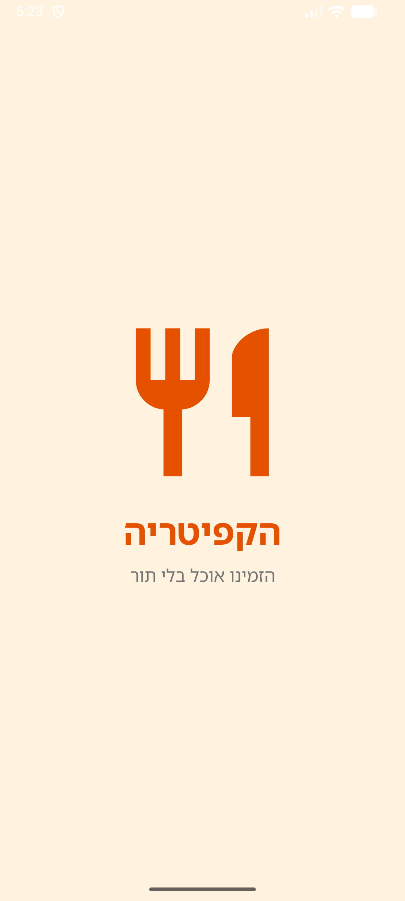
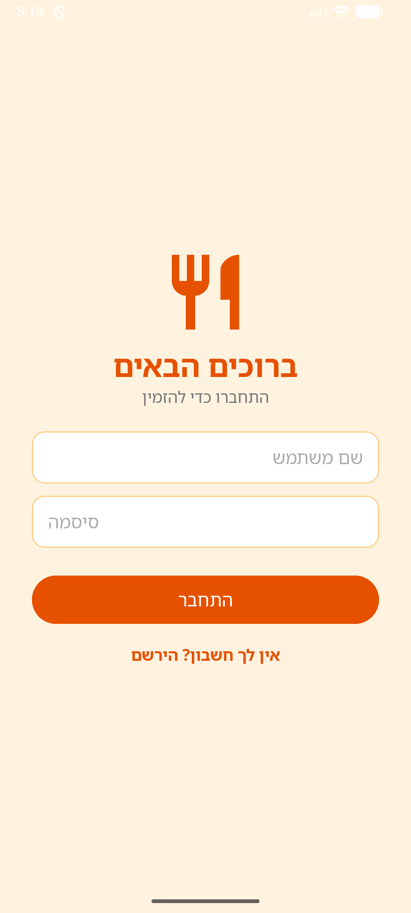
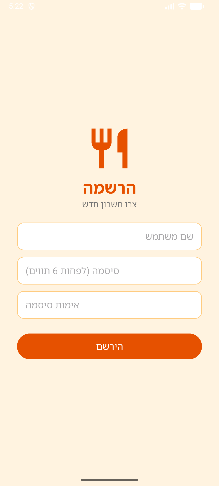

# הקפיטריה – CafeteriaApp

**תלמיד:** ארטמי

## הבעיה
בזמן ההפסקות התלמידים מבזבזים חלק גדול מהזמן בתור לקפיטריה, ולפעמים לא מספיקים לאכול לפני השיעור הבא.

## מטרת האפליקציה
להפוך את קניית האוכל למהירה יותר ולהקטין את הצפיפות בקפיטריה.

## המסכים

### מסך פתיחה (Splash)
לוגו שמופיע באנימציה (הופעה הדרגתית וגדילה). אחרי 3 שניות האפליקציה עוברת לבד למסך הכניסה, בעזרת Thread.

### מסך כניסה (Sign In)
שם משתמש וסיסמה (הסיסמה מוסתרת). בדיקה ששום שדה לא ריק, והודעה ברורה על הצלחה או שגיאה. קישור למסך ההרשמה.

### מסך הרשמה (Sign Up)
שם משתמש, סיסמה ואימות סיסמה. הסיסמה באורך 6 תווים לפחות ושתי הסיסמאות זהות, והשגיאה מוצגת ליד השדה הבעייתי. אחרי ההרשמה הפרטים עוברים למסך הכניסה בעזרת Intent.

## טכנולוגיות
Java · Android Studio
